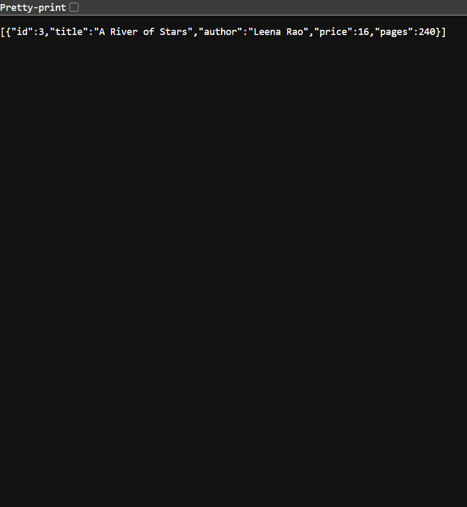
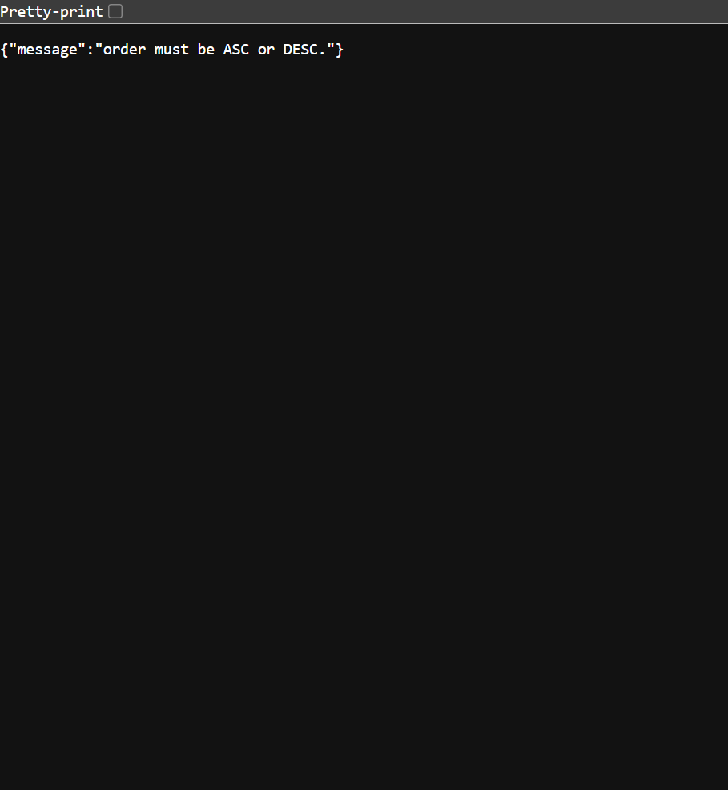

# Lab 3: REST API, query parameters, validation, debugging

**Name:** Spoorthi Valluri

**Registration number:** Not provided

**Class & Section:** 211 & CSE - 2E

**Subject:** Backend Development Fundamentals

**Live API:** Pending Render deployment. The service is configured for Render's free web service in [`../render.yaml`](../render.yaml); create the Blueprint in your Render account before a public URL exists. Add the actual URL here after Render creates it.

**GitHub repository:** [spoorthivalluri/spoorthi-valluri-backend-development-fundamentals](https://github.com/spoorthivalluri/spoorthi-valluri-backend-development-fundamentals/tree/main/lab-03)

## Project description

A REST API built with Node.js, Express, and SQLite for managing books. It supports title search, sorting, pagination, price-range filters, input validation, and consistent JSON error responses. The SQLite database and ten sample books are created automatically when the server starts.

## Install and run

From the repository root:

```bash
cd lab-03
npm install
npm start
```

The API listens at `http://localhost:3000`. If that port is in use, start it on a different port in PowerShell:

```powershell
$env:PORT=3001
npm start
```

No environment variables are required for local use. Render supplies `PORT` automatically. The generated `books.db` is local runtime data and is not committed; on a free Render instance it may reset when the service restarts.

### Deploy to Render

1. Sign in to Render and create a Blueprint using this GitHub repository.
2. Approve the service described in `render.yaml` at the repository root.
3. Confirm the web service uses the **Free** plan, then create the Blueprint.
4. After the first successful deploy, copy the service URL into the **Live API** line above and verify `/` and `/books`.

## Endpoints

| Method | Path | Description |
|---|---|---|
| GET | `/` | Health check and API welcome message. |
| GET | `/books` | List books; supports search, sorting, pagination, and price filters. |
| GET | `/books/:bookId` | Return one book, or a JSON error if it does not exist. |
| POST | `/books` | Create a book; returns `201` or a JSON validation error with `400`. |
| PUT | `/books/:bookId` | Replace a book's details; returns `200`, `400`, or `404`. |
| DELETE | `/books/:bookId` | Delete a book; returns `200`, `400`, or `404`. |

### `GET /books` query parameters

| Parameter | Default | Description |
|---|---|---|
| `search_q` | empty | Partial, case-insensitive title search. |
| `order_by` | `id` | Sort column: `id`, `title`, `author`, `price`, or `pages`. |
| `order` | `ASC` | Sort direction: `ASC` or `DESC`. |
| `limit` | `10` | Maximum number of returned books; must be a positive integer. |
| `offset` | `0` | Number of matching books to skip; must be a non-negative integer. |
| `min_price` | none | Optional inclusive minimum price. |
| `max_price` | none | Optional inclusive maximum price. |

Example:

```text
GET /books?search_q=river&order_by=price&order=DESC&limit=5&offset=0&min_price=10&max_price=30
```

Create and update requests expect JSON with a non-empty `title`, a non-empty `author`, a non-negative numeric `price`, and a positive integer `pages`:

```json
{
  "title": "A New Beginning",
  "author": "Spoorthi Valluri",
  "price": 25,
  "pages": 240
}
```

All errors use a JSON object with a `message` field. SQL values are parameterized; only sort columns and directions from fixed allowlists are interpolated into the SQL statement.

## Test the API

Run the automated integration tests:

```bash
npm test
```

The tests cover:

- Listing books with defaults; title search, sorting, pagination, and min/max price filtering.
- Invalid sort columns, sort directions, limits, and price filters.
- Getting an existing book, a missing book (`404`), and an invalid ID (`400`).
- Creating a book (`201`), missing required fields, and a non-numeric price (`400`).
- Malformed JSON (`400`).
- Updating and deleting existing books (`200`) and handling missing IDs (`404`).

For manual/Postman checks, send the same requests above and verify the status codes and JSON messages. The screenshots below show actual responses from the locally running API; add further screenshots after testing the deployed service.

## Debugging notes

- **Port conflict (`EADDRINUSE`):** Stop the other server or choose an unused `PORT` as shown above.
- **Wrong import path:** Run `npm start` from `lab-03`; imports use installed package names and paths relative to `app.js`.
- **Missing table:** `openDatabase()` creates the `book` table before the server starts.
- **Missing `await`:** Database reads and writes are awaited before their results are used or returned.

## Screenshots





These are browser captures of the API's JSON responses. Add further screenshots of create/update/delete and not-found cases after testing the deployed service.
